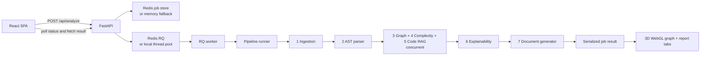

# Project Gnosis — Coding Agent Handoff

This is the practical handoff for coding agents working in this repository. Read it before changing code. It summarizes the current implementation and identifies which older project documents have drifted from the source.

## Project in one paragraph

Project Gnosis (also called Archaeon) accepts a GitHub repository and builds an engineering onboarding report. Its Python pipeline ingests repository files, parses symbols with tree-sitter, builds a NetworkX dependency graph, scores code complexity and risk, indexes code chunks in ChromaDB using NVIDIA-hosted embeddings, asks an NVIDIA-hosted LLM for explanations, and generates Markdown/JSON reports. A FastAPI service accepts jobs and reports progress; Redis/RQ can dispatch work to separate workers. The React/TypeScript SPA submits jobs, polls progress, and presents the results.

## Start here

- **Current frontend and app flow:** `frontend/src/App.tsx`. It owns the landing, progress, and results screens; this is not currently a React Router application.
- **Active interactive 3D dependency graph:** `frontend/src/components/DependencyGraph3D.tsx`. It is lazy-loaded from the dependency tab in `App.tsx`.
- **Frontend styling:** `frontend/src/index.css`. The UI also contains inline styles in `App.tsx`.
- **API and job lifecycle:** `src/api/main.py`, `src/api/queue.py`, `src/api/job_store.py`, `src/api/worker.py`.
- **API pipeline execution and result serialization:** `src/api/pipeline_runner.py`.
- **Shared pipeline state:** `src/state.py`.
- **Agent implementations:** `src/agents/`.
- **Language filtering and extension detection:** `src/utils/filters.py`.
- **Tree-sitter grammar factory:** `src/utils/tree_sitter_utils.py`.
- **Parser helpers/models:** `src/parsers/`.
- **CLI orchestration:** `run.py` and `src/orchestrator.py`.
- **Existing automated checks:** `tests/` and `frontend/tsconfig.json`.
- **Current feature backlog:** `ROADMAP.md` (some older roadmap documents disagree with current code).

## Repository layout

```text
src/
  agents/       ingestion, AST parsing, dependency graph, complexity, code RAG,
                explanations, and document generation
  api/          FastAPI routes, worker queue, Redis/in-memory job store,
                background worker, and API pipeline runner
  parsers/      language-specific AST parsing and complexity helpers
  utils/        GitHub API, filtering, graph helpers, embeddings, retrieval,
                cache, diff engine, metrics, and NVIDIA client
frontend/
  src/App.tsx   active SPA screens and result tabs
  src/components/DependencyGraph3D.tsx
  src/pages/ResultsPage.tsx  older separate page; not imported by active App.tsx
  src/types/api.ts
  src/index.css
tests/          pytest suites for API, agents, parsing, queue/store, and updates
outputs/        generated CLI reports; ignored by git
chroma_db/      local persistent ChromaDB data; ignored by git
```

There are also vendored assets under `lib/`, design/reference documents, historical/imported source snippets under `frontend/src/imports/`, and deployment workflows under `.github/workflows/`. Do not mistake imported snippets or `frontend/src/pages/ResultsPage.tsx` for the active app without checking their imports.

## Local development

### Backend

Use Python 3.11 or 3.12 in a virtual environment. Docker uses Python 3.11; the Azure API workflow currently installs Python 3.12.

```powershell
py -3.11 -m venv .venv
.\.venv\Scripts\Activate.ps1
python -m pip install -r requirements.txt
if (-not (Test-Path .env)) { Copy-Item .env.example .env }
uvicorn src.api.main:app --reload --port 8000
```

Fill in `.env` with real credentials as needed. Never copy credentials into source, documentation, command output, or commits. `NVIDIA_API_KEY` is required for Agent 5 hosted embeddings; it is also needed for Agent 6 explanations unless LLM explanations are skipped. A GitHub PAT is optional for public repositories and raises API limits; the CLI accepts `--token` and the API accepts a token in its request options. The current landing page does not expose a PAT field.

### Frontend

```powershell
Set-Location frontend
npm install
npm run dev
```

The Vite dev server runs on port 8443 by default and proxies `/api` to `http://localhost:8000`. `VITE_API_URL` can override the API base URL. Production builds use `npm run build`; `npx tsc --noEmit` runs the TypeScript checker separately because the Vite build does not type-check the full project.

### Docker Compose

`docker compose up --build` starts Redis, the FastAPI backend, and a separate RQ worker. Compose expects a root `.env` file. The worker and API share the Redis URL and local volume in this development setup.

### CLI

```powershell
python run.py --url https://github.com/owner/repo --skip-llm
python run.py --url https://github.com/owner/repo --max-explain 5
python run.py --url https://github.com/owner/repo --token <PAT> --incremental
```

The CLI writes reports to `./outputs` by default; `--output` changes that directory and `--no-html` skips the pyvis HTML graph. The CLI also offers `--test-rag`, which runs sample retrieval queries after analysis.

## Runtime architecture and data flow



1. `POST /api/analyze` validates the GitHub URL, fetches repository metadata and the default branch, checks the supported-file count, creates a job, and queues it.
2. With a reachable `REDIS_URL`, jobs use Redis storage and RQ. Otherwise, the API falls back to an in-process thread pool and in-memory job store. Production deployments use a separate worker process.
3. `src/api/pipeline_runner.py` runs metadata and ingestion, then AST parsing. Dependency graph, complexity scoring, and Code RAG run concurrently. Graph coupling is applied after the concurrent work completes; explanations and document generation follow.
4. The frontend polls job status and then fetches the result. The active routes are `/api/analyze`, `/api/jobs/{job_id}`, and `/api/jobs/{job_id}/result`; non-`/api` aliases also exist in `src/api/main.py`.

### Pipeline stages

| Stage | Main implementation | Output / notes |
|---|---|---|
| 1. Ingestion | `src/agents/ingestion.py`, `src/utils/github_api.py` | File manifest and raw file contents; concurrent GitHub file fetches |
| 2. AST parser | `src/agents/ast_parser.py`, `src/parsers/` | Functions, classes, imports, parse errors |
| 3. Dependency graph | `src/agents/dependency_graph.py` | Directed NetworkX graph, cycles, graph statistics, reading order |
| 4. Complexity scorer | `src/agents/complexity_scorer.py`, `src/parsers/complexity.py` | Cyclomatic scores, risk levels, risk reasons |
| 5. Code RAG | `src/agents/code_rag.py`, `src/utils/chunker.py`, `src/utils/embedder.py` | AST-aware chunks in persistent ChromaDB; NVIDIA NIM embeddings |
| 6. Explainability | `src/agents/explainability.py`, `src/utils/retriever.py`, `src/utils/nvidia_client.py` | Explanations for selected files, with a disk explanation cache |
| 7. Document generator | `src/agents/doc_generator.py` | Onboarding Markdown, agent context, file explanations, complexity JSON |

## API and result contracts

- Submission request supports `repo_url`, `max_explanations`, `skip_llm`, `github_token`, `incremental`, and an optional `options` object. The frontend currently sends `repo_url`, `max_explanations`, and `skip_llm`.
- Job statuses are `queued`, `running`, `complete`, and `failed`; phases are stored in the job store and surfaced to the progress screen.
- The result includes report strings, summaries, explanations, compact `dependency_rows`, complexity rows, reading order, and `graph_data`.
- `graph_data.nodes` contains every file node with `id`, `path`, `file`, `risk`, `imported_by`, and `imports`. `graph_data.links` contains directed `{source, target}` edges. Compatibility fields (`edges`, `in_degree`, `out_degree`, `topological_order`) remain available for the older standalone results component.
- The 3D graph requires the full graph payload; do not truncate `graph_data.nodes` or `graph_data.links` to the ten summary rows. Keep the compact `dependency_rows` separate for the “most imported files” table.
- `src/api/models.py` defines the typed FastAPI result contract. Keep it in sync with the serializer and `frontend/src/types/api.ts` where that interface is used.

## Current frontend behavior and design rules

- `App.tsx` contains the active landing, progress, and result screens. Results tabs include onboarding, agent context, file explanations, dependency graph, complexity report, and raw output.
- `DependencyGraph3D.tsx` uses `3d-force-graph` / Three.js WebGL and is lazy-loaded. It supports orbit, pan, zoom, selecting a node, clustering by top-level directory, search by path, and filtering by risk.
- The graph uses the Gnosis content-area colors (`#F0F0FF` ivory, electric blue `#1400FF`, darker blue `#0F00CC`), sharp square controls, and IBM Plex Mono instrumentation labels. Risk colors are shades within the blue palette. Keep graph chrome visually consistent with `App.tsx`; avoid generic dark Three.js defaults, rounded cards, gradients, or glass effects.
- App version is the `APP_VERSION` constant in `frontend/src/App.tsx`. The current value is `1.1.0`.
- The graph has a graceful message when WebGL is unavailable or the result lacks graph data. Keep interaction controls usable on narrow screens and respect reduced-motion expectations for any new animated UI.
- The `three` dependency is intentionally constrained to `^0.179.1`. Newer peer-compatible releases removed postprocessing modules imported by `three-render-objects`, which broke the Vite production build in this project.
- The standalone `frontend/src/pages/ResultsPage.tsx` is legacy/unreferenced by the active `App.tsx`; check imports before modifying it as if it were the shipped page.

## Languages and repository limits

Current tree-sitter languages: **Python, JavaScript, TypeScript/TSX, Go, Rust, Java, C, and C++**. `src/utils/filters.py` is the source for accepted extensions and language detection; `src/utils/tree_sitter_utils.py` maps supported languages to installed grammar packages. YAML, TOML, and Markdown can be ingested as context but do not have the same AST support. C#, Scala, Elixir, Dart/Flutter, and Zig remain roadmap items.

Default tier boundaries in `src/agents/ingestion.py`:

- Up to 300 files: full analysis.
- 301–1,000 files: full analysis with warning.
- 1,001–3,000 files: sampled analysis for deeper work.
- More than the configured sampled maximum (default 3,000): rejected by the API/CLI precheck.

Relevant environment overrides include `MAX_FULL_ANALYSIS_FILES`, `MAX_WARNING_ANALYSIS_FILES`, and `MAX_SAMPLED_ANALYSIS_FILES`.

## Dependencies, models, and data storage

- Python dependencies are in root `requirements.txt`; frontend dependencies and scripts are in `frontend/package.json`.
- Graph and complexity stages use NetworkX and tree-sitter; Python complexity uses Radon.
- ChromaDB persists under `./chroma_db` by default. `src/api/main.py` and `src/api/worker.py` attempt to substitute `pysqlite3` for SQLite in Azure environments that ship an old SQLite version.
- Embeddings use NVIDIA NIM `nvidia/nemotron-3-embed-1b` (2048 dimensions) in `src/utils/embedder.py`.
- Explanations use NVIDIA NIM through an OpenAI-compatible client. Current default: `meta/llama-3.2-11b-vision-instruct`; `NVIDIA_BASE_URL` and `NVIDIA_MODEL` can override runtime defaults.
- `REDIS_URL` enables Redis-backed job storage and queue dispatch. Related settings include `RQ_QUEUE_NAME`, `JOB_TIMEOUT_SECONDS`, and `JOB_TTL_SECONDS`.
- `GITHUB_TOKEN` is the optional backend/CLI token. GitHub private repository fetch support exists in the backend/CLI, but the frontend currently has no PAT control or OAuth login.
- **Token handling caveat:** the API currently includes request options in job records, and the Redis job store serializes those options. Treat a user-supplied PAT as sensitive; do not enable or expand frontend token submission without changing storage/redaction behavior.
- Never commit `.env`, credentials, analysis outputs, ChromaDB data, or generated caches. `.gitignore` excludes these runtime artifacts.

## Roadmap status (current code, not older prose)

Already implemented: seven-stage pipeline; concurrent AST/file work and concurrent graph/complexity/RAG stages; Redis/RQ with local fallbacks; public-repository analysis; PAT-capable backend/CLI fetch path; incremental diff/state reuse; 3D WebGL graph with search, risk filters, directory clustering, and node details; Markdown/JSON/pyvis outputs.

Still planned in `ROADMAP.md`: user-configurable LLM/API keys; permanent share links; branch/tag selection; interactive repo Q&A; PDF report export; GitHub App/OAuth; local/ZIP upload; monorepo workspace boundaries; PR impact analysis; dead-code detector; C#/Scala/Elixir/Dart/Zig; syntax-highlighted source viewer; light theme toggle; recent history; batch repository comparison; popular-repository result caching; queue-depth worker autoscaling; email/webhook notifications; and backend rate limits/quotas.

Other ideas in the README’s older v2/v3 section—GitHub Action analysis integration, team annotations/export, and autonomous iterative analysis—are not implemented. Existing GitHub Actions deploy services; they do not run an analysis on a user repository’s PR.

## Documentation drift and source of truth

Some existing documents describe earlier designs. When they conflict with current code, prefer the current source and this handoff. In particular:

- `README.md` still describes sequential stages, in-memory-only job storage, and old v2 plans in places; current pipeline phases 3–5 run concurrently and Redis/RQ is implemented.
- `PROJECT_SPEC.md` has older embedding/model/worker details and earlier architecture descriptions.
- `SCRATCHPAD.md` retains items marked future that are already implemented (parallel execution and incremental analysis).
- `ChangeLog.md` records a PAT frontend control that is absent from current `App.tsx`; verify features against code rather than changelog text.
- `.env.example` includes an older NVIDIA model comment; use defaults in `src/utils/embedder.py` and `src/utils/nvidia_client.py` as the current runtime source.
- The active front-end version (`APP_VERSION`) is authoritative for the visible footer; API `VERSION` and old release prose may not match it.

When adding a feature, keep API models, result serialization, frontend interfaces, docs, and the roadmap aligned. Do not claim deployment or live integration has been verified unless it actually has.

## Tests and verification

Python tests are in `tests/`; run the relevant pytest file(s) for a requested testing task. Frontend type checking is `cd frontend && npx tsc --noEmit`; production bundling is `cd frontend && npm run build`. Do not add or run tests unless the user requests tests or verification. Avoid reporting a build as a test suite.

The project has no single frontend test script configured in `package.json`. Recent graph work was type-checked and production-built; the Vite build may report a large lazy graph chunk and existing Vite config-loader notices.

## Project conventions

- Keep agent responsibilities separate; pass pipeline data through `ArchaeonState` rather than having agents call each other directly.
- Preserve the current analysis result as JSON-serializable data; do not put NetworkX objects, parser trees, clients, or secrets into result payloads.
- Keep expensive graph rendering out of the initial frontend bundle. Treat the dependency graph as directed: source/importer points to imported target.
- Preserve graceful behavior for unavailable grammars, parse failures, missing optional LLM explanations, unavailable WebGL, and unreachable Redis.
- Use `.env.example` as a key-name reference only; check implementation defaults because the example comments may lag.
- Before changing deployment, inspect `.github/workflows/` and current environment configuration. The API and worker have separate Azure deployment workflows; frontend delivery is through Vercel configuration.
- Do not send messages to external services or deploy without the user explicitly asking for that action.

## Workspace rules from `GEMINI.md`

`GEMINI.md` contains workspace-wide instructions that apply on every interaction. Read it when the rules change; the following requirements are included here so a coding agent does not miss them:

- After **any codebase edit**, automatically update all three root files:
  - `ChangeLog.md`: chronological record of changes.
  - `Decisions.md`: rationale for technical choices and implementation decisions.
  - `Flow.md`: current component, agent, endpoint, helper, and data flow; update its Mermaid diagram when appropriate.
- Do these updates without asking the user. Keep all three files excluded from Git in `.gitignore`.
- If changing a release version, follow the project’s semantic versioning rules:
  - **Patch (`X.Y.Z` → `X.Y.Z+1`)** for small fixes, styling, tests, and small documentation changes.
  - **Minor (`X.Y.Z` → `X.Y+1.0`)** for substantial refactors, core helpers/agents, and significant features within existing functionality.
  - **Major (`X.Y.Z` → `X+1.0.0`)** for a full frontend revamp, a new system capability/agent, or a fundamental change to project behavior/orchestration.
  - Keep the single frontend `APP_VERSION` in `frontend/src/App.tsx` synchronized with the codebase release version.
